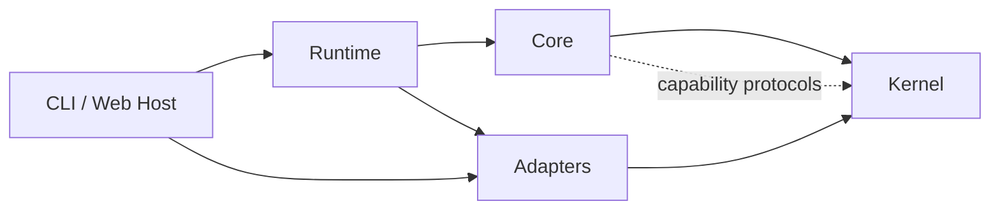
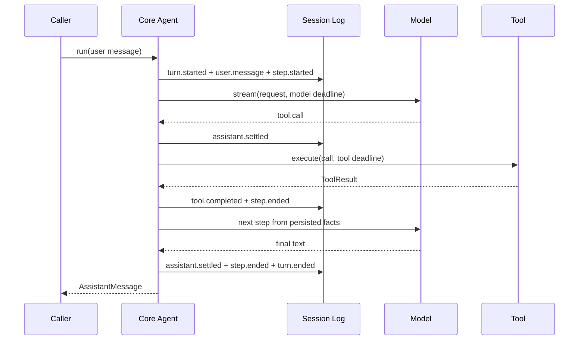

# 架构与执行图

GitHub 会直接渲染本文件中的 Mermaid 图。它们用于帮助读者快速理解运行时的所有权和一次工具回合的持久化事实。

## 依赖与组合边界

`kernel` 只定义协议无关概念和通用工具运行时；`core` 只拥有单 Agent 循环；具体 I/O 由 adapter 实现，Host 保留凭据、配置和进程交互边界。

## 一次含工具调用的 turn

模型流 chunk 是临时通知；`assistant.settled`、`tool.completed` 与生命周期事件才是可重放、可恢复的会话事实。更多失败、取消和恢复语义见 [架构说明](architecture.md)。
